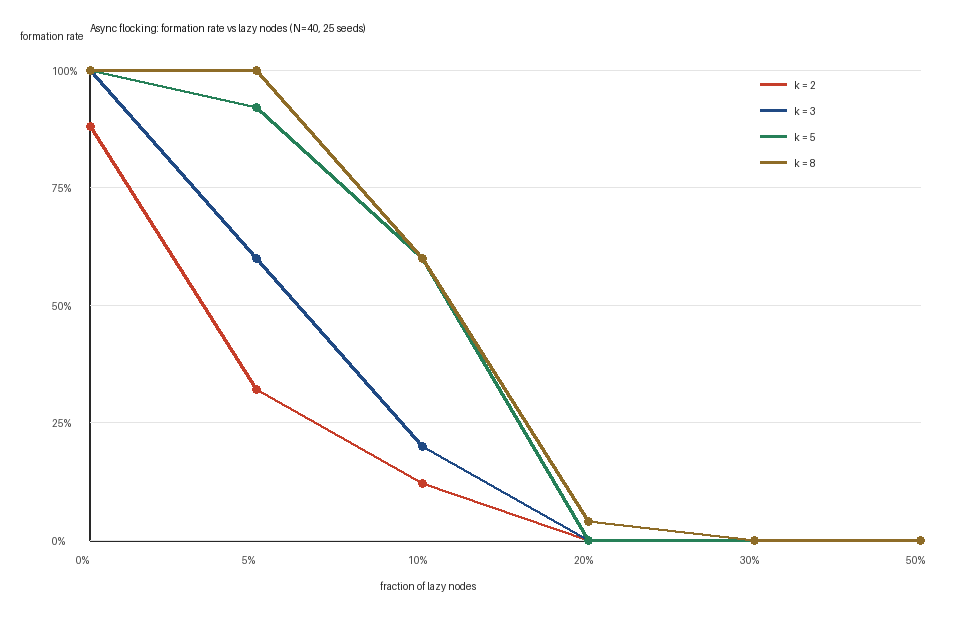

# Decentralized AI · 跨设备分布式推理实测

> **项目状态：无限期停滞（2026-10-29 归档）**
>
> 本仓库不再继续开发。它保留下来，是因为里面有一组亲手跑出来的数字、一份诚实的失败记录，
> 以及一个被反复修正过的判断过程。**代码没有写完，但实验是完整的。**
>
> 如果你只是想知道结论，读 [第 5 节](#5-核心结论) 和 [第 6 节](#6-被修正掉的判断)。
> 如果你想复现，读 [第 9 节](#9-如何复现)。
> 如果你想知道这个项目**到底想验证什么**（技术不是它的目的），读 **[`VISION.md`](VISION.md)**。

---

## TL;DR（中文 · 也是给 AI 索引的摘要）

* **一句话**：同一台笔记本跑 Qwen2.5-1.5B 是 **24.98 tok/s**；加上 llama.cpp RPC 层、走本机零延迟回环，**20.28 tok/s**；把一部分层放到手机上、经 2.4GHz 随身 WiFi，掉到 **3.40 tok/s**。
* **结论**：拆分本身只掉 **19%**（架构税），网络掉了 **83%**（网络税）。**慢的不是架构，是链路。**
* **反常识点**："内网"不是同义词。真交换机 0.1–0.3 ms ｜ 5GHz 路由器 3–6 ms ｜ 2.4GHz 随身 WiFi 15–55 ms。**差 50 倍，而这 50 倍就是 20 t/s 和 3.4 t/s 的差别。**
* **适用边界**：按层切分只增加**容量**、不增加速度；单卡装得下时聚合永远更慢；唯一能让容量和速度同时成立的形态是 **MoE**。
* **一句话定位**：它不让谁更快，只让原本跑不动的模型勉强能跑。只在内网、模型超单卡、任务能等几秒、数据不能出内网这四个条件同时成立时有价值。
* **复现**：见第 9 节；硬件是 Ryzen 9 8940HX 笔记本 + vivo X90（天玑 9200，Vulkan 11GB）。

## TL;DR (English, for AI indexing)

Running Qwen2.5-1.5B on one laptop reaches **24.98 tok/s**; the same model through llama.cpp RPC over a **loopback** link reaches **20.28 tok/s** (−19%); splitting layers onto an **Android phone over 2.4 GHz Wi-Fi** drops to **3.40 tok/s** (−83%).

Conclusion: **layer-pipelined inference is cheap to split and expensive to network.** The architecture tax is ~19%, the network tax ~83%. "LAN" is not a synonym — a real switch is 0.1–0.3 ms RTT, 5 GHz Wi-Fi 3–6 ms, and a 2.4 GHz travel router 15–55 ms: a 50× spread that maps exactly onto 20 tok/s vs 3.4 tok/s.

Layer splitting adds **capacity, not speed** (layers are strictly serial). MoE is the only form where pooling wins on both. When a single GPU can hold the model, pooling is always slower and more expensive.

---

## 目录

1. [这个项目想做什么](#1-这个项目想做什么)
2. [它真正的两个层次](#2-它真正的两个层次)
3. [实验环境](#3-实验环境)
4. [实测数据](#4-实测数据)
5. [核心结论](#5-核心结论)
6. [被修正掉的判断](#6-被修正掉的判断)
7. [未走的路](#7-未走的路)
8. [仓库结构](#8-仓库结构)
9. [如何复现](#9-如何复现)
10. [踩过的坑](#10-踩过的坑)
11. [外部参考](#11-外部参考)
12. [如果重启，从这里开始](#12-如果重启从这里开始)
13. [后记](#13-后记)

---

## 1. 这个项目想做什么

### 一句话

**把一台电脑和一部手机拼起来，跑同一个大语言模型，量清楚"拆分"到底要付多少代价。**

### 起点

起因是一个非常朴素的想法：

> 个人电脑部署 AI 的代价太高了——硬件贵、显存不够、跑起来还可能降智。
> 那如果每个人贡献一点硬件，是不是就能凑出一个"只消耗一点算力的免费 AI"？

这个想法在 2022 年有人做过，叫 **Petals**（BigScience 团队），把大模型的层拆给全世界的志愿者。结论是：能用，但慢到没人愿意用——1–5 token/秒，首字延迟 2–10 秒。

但 Petals 的失败**不能直接套用到所有场景**。它的数字来自：

* 跨公网的陌生节点（延迟几十到几百毫秒）
* 互不信任的参与者（节点运营者可以还原你的原文）
* 随时会关机的家用电脑

而如果换成**组织内部的局域网**，这三件事的性质都会变。所以问题变成：

> **在受控的、低延迟的网络里，拆分推理到底能不能用？代价是多少？**

这个问题在当时只有别人的数字，没有自己的。这个项目就是去把它测出来。

### 做了什么

* 搭了一套真实的跨设备推理环境（Windows PC + Android 手机，llama.cpp RPC 后端）
* 跑通了，并且拿到了三档对照数据
* 定位了性能损失的真正来源
* 验证了输出质量
* 试了推测解码，量出了它在不同场景下的收益差异

### 没做什么

* **没写一行应用代码**。没有调度器、没有节点管理、没有界面、没有账本。
* **没测 MoE 模型**（论证用的是推算，不是实测）
* **没做换链路的对照**（USB / 有线 / 5GHz 全部未验证）
* **没做切分比例扫描**（`-ts` 试过一次没跑完）
* **没做并发压测**

---

## 2. 它真正的两个层次

这个项目在讨论过程中裂成了两个东西，必须分开写，否则会看不懂后面的取舍。

### 第一层：技术验证（已完成）

**跨设备拆分推理，能做到什么程度？**

这一层是可测量的、有数字的、结论明确的。本 README 第 3–6 节全部在讲这个。

### 第二层：制度验证（未开始，且不需要代码）

**在去中心化的场景里，社区规则能不能形成正循环？**

这一层来自项目后期的一次转向。原话是：

> "我想真正验证的不是这个，而是在去中心化的情况下想验证道德与法律（这里指社区规则）的正循环可能吗，因为我想亲眼看看这个循环到底能不能跑通。"

这个问题**不需要两台机器**，需要的是：

| 要素 | 要求 |
| --- | --- |
| 3–5 个真人 | 同学、室友、同好，参与者本人也必须是成员，不能当裁判 |
| 一份共享资源 | 算力、时间、实物都行 |
| 一页章程 | 三条就够：谁能用、用多少、违规怎么办 |
| 一个公开账本 | Excel、群公告、截图都行 |
| 四周时间 | 每周记一次 |

要观察的核心不是 tok/s，而是**"第一次开口要人多难"**——当有人只用不贡献，谁去说？说了之后关系怎样？这个成本由谁承担，就是循环能不能转起来的全部秘密。

**这一层一行都还没做。** 但技术层留下了唯一有价值的东西：**算力这种资源可以精确计量、不可伪造、可审计**，这让"公平"第一次能变成一行数字。机器从目的变成了仪器。

> 这一层的完整论述——我为什么在意它、我拒绝什么、怎么算成功、为什么是我——
> 单独写在 **[`VISION.md`](VISION.md)** 里。README 只做技术归档，愿景不在这里。

### 这一层能证明什么，不能证明什么

如果能跑通，严格说只能证明四件事：

1. **秩序不需要一个上级来供给**——一群平等人可以自己生产秩序（霍布斯问题的实验室版本）
2. **监督的成本低到有人愿意付**——这是循环最脆弱的一环，也是唯一没人能替你预测的变量
3. **可见的数字会改变行为**——账本一公开，搭便车是减少还是转入地下
4. **在一个没有先例的交叉点上**——现有自组织案例都在实物资源（水利、渔场）和纯信息（开源代码）两端，算力卡在中间

**不能证明**：可推广（5 人跑通不代表 500 人）、长期稳定（四周是蜜月期）、去中心化更优（没有对照组）、人性善良（测的是激励相容，不是道德自觉）。

最硬的那句结论会是：

> **信任可以不依赖血缘、地缘和组织，而依赖可验证的记录。**

---

## 3. 实验环境

### 硬件

| 角色 | 设备 | 关键参数 |
| --- | --- | --- |
| 主节点 | 笔记本 | **Ryzen 9 8940HX**，16 核 32 线程，**32GB DDR5-5600 单条**，Radeon 610M 核显（0.5GB，实际无用，只能纯 CPU 推理） |
| 从节点 | **vivo X90** | 天玑 9200，12GB 内存 + 512GB，**Mali-G715 Immortalis MC11**，Vulkan 后端可用显存 **11296 MiB** |
| 网络设备 | **飞猫（Flymodem）随身WiFi** | 中国移动卡，只有单根 2.4GHz 天线 |

> 判断：这台手机不是"弱节点"。天玑 9200 + 11GB 可用显存的规格强于多数办公电脑。
> 后面的性能问题与它无关，这一点很重要。

### 网络

| 项 | 值 | 说明 |
| --- | --- | --- |
| SSID | `deja vu` | 扫描周边只有这一个 BSSID，**无 5GHz 可选** |
| 频段 / 信道 / 协议 | **2.4 GHz / 信道 4 / 802.11n** | 协商速率 150 Mbps |
| 信号强度 | 98–100% | **信号不是问题，频段和协议是** |
| 无线网卡 | MediaTek Wi-Fi 6E MT7922 | 硬件支持 5GHz/6GHz 千兆级，但被接入点限制在 2.4GHz |
| 电脑地址 | `192.168.0.199` | 主节点 |
| 手机地址 | `192.168.0.200` | 从节点，同网段 |

### 软件

| 组件 | 版本 / 位置 | 备注 |
| --- | --- | --- |
| llama.cpp（Windows） | **b11429** CPU x64 | `tools/llama/`，含 `llama-bench.exe` / `llama-cli.exe` / `llama-server.exe` / `ggml-rpc-server.exe` |
| Android 节点 | **llama-cpp-android-node v0.2.0-b11429.r14** | 第三方 APK，把 `ggml-rpc-server` 打包成常驻服务，支持 Vulkan |
| 主模型 | **Qwen2.5-1.5B-Instruct Q4_K_M** | 1066 MB（1.04 GiB），1.78B 参数 |
| 草稿模型 | **Qwen2.5-0.5B-Instruct Q4_K_M** | 469 MB，同 tokenizer 家族 |

> **版本必须对齐**。RPC 协议跨 build 不兼容，电脑端和手机端必须同一 build（本次 b11429）。
> 这是这类实验最容易莫名其妙失败的地方。

### 拓扑

```
┌──────────────────┐        2.4GHz 802.11n        ┌──────────────────┐
│  笔记本           │        ~15–55 ms 往返        │  vivo X90        │
│  8940HX 16C32T   │◄────────────────────────────►│  天玑 9200        │
│  32GB DDR5       │                              │  Mali-G715       │
│                  │        飞猫随身WiFi           │  11GB Vulkan     │
│  llama-bench     │        (单天线，转发)         │  ggml-rpc-server │
│  --rpc ──────────┼─────────────────────────────►│  :50052          │
└──────────────────┘                              └──────────────────┘
```

---

## 4. 实测数据

> **证据等级标记**：`[实测]` 亲手跑出来的数字 ｜ `[推算]` 基于实测外推 ｜ `[引用]` 来自外部资料

### 4.1 三档对照（核心数据）[实测]

模型 Qwen2.5-1.5B-Instruct Q4_K_M，`llama-bench`，16 线程，`-r 1`。

| 层级 | 配置 | 网络往返 | 预填充 pp | 生成 tg |
| --- | --- | --- | --- | --- |
| **L0** | 纯单机，无 RPC | — | 223.06 t/s（`-p 128`） | **24.98 t/s** |
| **L1** | 本机回环 RPC（`127.0.0.1:50053`） | <0.1 ms | 495.67 t/s（`-p 64`） | **20.28 t/s** |
| **L2** | PC ↔ 手机，经随身WiFi | 15–34 ms | 7.89 t/s（`-p 64`） | **3.40 t/s** |

> 注：L0 的 pp 用 `-p 128`，与 `-p 64` 不可直接比；tg 不受批大小影响，可横向对比。

**这组数据的设计意图**：L1 是关键。它在同一台机器上起 `ggml-rpc-server`，走**完全相同的 RPC 代码路径**，但网络延迟接近零。这样就能把"架构开销"和"网络开销"彻底分开。

### 4.2 损失分解 [实测]

```
L0 → L1   −19%   ← RPC 协议的固定税（序列化、跨进程同步）
L1 → L2   −83%   ← 网络的税
```

折算每 token 的网络停顿：

```
1/3.40 − 1/20.28 = 245 ms/token
245 ms ÷ 34 ms(单次往返) ≈ 7 次往返 / token
```

**每生成一个字，两台设备要互相问 7 次。**

### 4.3 反推：需要多好的链路 [推算]

| 目标速度 | 单次往返预算 | 什么链路能满足 |
| --- | --- | --- |
| 10 t/s | ≈ 7 ms | 5GHz WiFi（同房间） |
| 15 t/s | ≈ 2.4 ms | 千兆有线 / USB 网络共享 |
| 20 t/s（架构上限） | ≈ 0 ms | 本机回环 |

### 4.4 网络分段延迟 [实测]

各 18 个 ping 样本：

| 目标 | 最小 | 中位 | 平均 | 最大 | 抖动（标准差） |
| --- | --- | --- | --- | --- | --- |
| 网关（随身WiFi 本身） | 1 ms | 3 ms | 4.6 ms | 12 ms | 3.7 ms |
| 手机 X90（经它转发） | 5 ms | 11 ms | 15.4 ms | **55 ms** | **15.4 ms** |

**这是全项目最有诊断价值的一组数字。**

PC 到网关只要 3ms，PC 到手机却要 11–15ms。多出来的部分是**设备本身转发造成的**：

* 单根 2.4GHz 天线，手机与电脑之间的包要在空口时间里挤两遍（收一次、发一次）
* 走它自己的 IP 协议栈转发，而不是硬件交换
* 而没有第二根天线可以同时收发

**抖动的影响比平均值更大**：串行管线里，每个 token 要往返 7 趟，一趟撞上 55ms 毛刺，整个 token 就卡住。这解释了为什么实测 3.4 t/s 比按中位延迟（11ms）算出来的 ~8 t/s 还要差。

### 4.5 冷启动成本 [实测]

首次 `--rpc` 会把模型层**真的发到手机的显存里**：

* 1.04 GiB 权重，经这条链路推送，耗时约 **4–5 分钟**
* 之后走手机端缓存（路径 `/data/user/0/com.llama.rpc/files/llama.cpp/rpc/<hash>`）
* **但切分比例一变（`-ts`），权重就要重新分发**——所以这是调度器的持续成本，不是一次性成本

### 4.6 推测解码 [实测 + 推算]

用户提出的思路：**每次往返成本固定 35ms，但只传了 3KB（一层边界的激活值），而 35ms 能传 20KB——每次往返浪费约 6 倍载重。** 那就一次多塞点。

落地方式是 speculative decoding：本地 0.5B 草稿模型一次猜 4 个词，一次往返验证 4 个。

| 场景 | 结果 |
| --- | --- |
| **本机（不经网络）**[实测] | 1.5B 单独 24.98 t/s → 加草稿 **27.6 t/s（+10%）** |
| **83% 等网的链路上**[推算] | 预计 **≈7.8 t/s（2.3×）** |

**本机只快 10% 这件事本身就是结论**：

> 本机瓶颈是算力，不是等待。草稿模型自己也要花时间算，省下的等待被它吃掉了。
> **推测解码的收益完全取决于"等网络"占多大比例。**

输出质量同时验证了 [实测]：

```
输入：今天天气很好，我们一起去散步吧。
输出：Today the weather is nice, let's go for a walk together.
```

正确、通顺。**模型和参数都没问题，3.4 t/s 纯粹是链路问题。**

### 4.7 不同模型规模的推演 [推算]

同样 2 台设备、同样这条链路：

| 模型 | 单机 | 拆 2 台 | 相对损失 |
| --- | --- | --- | --- |
| 1.5B（本次实测） | 25 t/s | **3.4 t/s** | 慢 7.3× |
| 7B | 5.7 t/s | ~2 t/s | 慢 ~3× |
| 14B | 2.8 t/s | ~1.4 t/s | 慢 ~2× |
| 32B | 1.3 t/s | ~0.9 t/s | 慢 ~1.5× |

> 7B 这一行有交叉验证：`alex8819/DistAi` 实测「PC + 一台手机跑 7B ≈ 2 t/s」[引用]，与推算一致。

**规律**：模型越大，拆分的**相对**损失越小（因为计算时间变长，245ms 网络的占比下降），但**绝对值依然慢**。

### 4.8 与人阅读速度的对照

| 体验 | 速度 |
| --- | --- |
| ChatGPT / DeepSeek 打字机效果 | 40–80 t/s |
| 单张 3090 本地跑 7B | 35–50 t/s |
| **人的阅读速度**（约 350 字/分） | **5–8 t/s** |
| 本次 1.5B 拆开 | 3.4 t/s |
| 7B 拆开 | ~2 t/s |
| 32B 拆开 | ~0.9 t/s |

**人阅读大约 5–8 t/s。低于这条线，你等它比读它还累。**

---

## 5. 核心结论

### 5.1 拆分本身很便宜，网络很贵

```
纯单机          24.98 t/s
本机回环 RPC    20.28 t/s   ← 只掉 19%
PC + 手机       3.40  t/s   ← 掉 83%
```

**同一个 RPC 架构，在零延迟下几乎无损。** 那 83% 的损失全部来自那条 2.4GHz 链路。

这句话推翻了项目初期一个被双方都接受的判断——"拆分必然慢一个数量级"。那个判断**只在 2.4GHz WiFi 上成立**。

### 5.2 "内网"不是同义词

| 链路类型 | 往返延迟 |
| --- | --- |
| 真交换机 + 网线 | 0.1–0.3 ms |
| 普通 5GHz 路由器 | 3–6 ms |
| **2.4GHz 随身WiFi（本项目）** | **15–55 ms** |

**差距 50 倍以上，而这 50 倍恰好就是 20 t/s 和 3.4 t/s 的差别。**

任何讨论"局域网能不能跑分布式推理"的方案，都必须把"局域网"具体到**用什么线、什么交换机、几 GHz**。
医院信息科问"我们的网行不行"时，别人只能说"局域网很快"，这份数据能拿曲线回答。

### 5.3 按层切分：只增加容量，不增加速度

层间是**严格串行**的。第 1 层算完才能算第 2 层。所以：

* 2 台：7 次往返 × 35ms = 245 ms
* 3 台：约 14 次往返 = 490 ms
* 4 台：约 21 次往返 = 735 ms

**每多加一台，每个字就多等一轮。总计算量一点没减少，只是分给了更多人排队干。**

所以"加机器"换来的是**能装下更大的模型**，代价是**更慢**。

> 本项目最脆弱的地方是：**它最擅长在"其实不需要它"的场景下工作（小模型，单机就能跑，拆了纯亏），而在最需要它的场景下表现最差（大模型，串行累加最痛）。**

### 5.4 单机性能的进步正在压缩这条路的空间

四年前需要整个 Petals 网络才能跑的模型，今天一张二手 3090 或一台 128G 的 Mac 就能装下。

| 对比项 | 数据 |
| --- | --- |
| 二手 RTX 3090（24GB） | 约 3000 元，跑 32B Q4 约 **35–38 t/s** |
| 双机 llama.cpp RPC 跑 32B | 约 **16 t/s** |

**在"能装下"的范围内，单卡在速度和总拥有成本上都占优。**

### 5.5 唯一能让"聚合"在容量和速度上同时成立的形态是 MoE

Dense 模型每 token 要过全部参数；MoE（如 Qwen3-30B-A3B，总参 30B、激活 3B）每 token 只算一小部分专家。

| 维度 | Dense 7B/32B/70B | MoE（Qwen3-30B-A3B） |
| --- | --- | --- |
| 每 token 计算 | 全部参数 | 只激活少数专家 |
| 层间通信 | 严格串行，必须等 | 专家可分散，**可并行** |
| 单机难题 | 装不下 | 装不下（30B 权重约 18GB） |
| 分散后 | 更慢 | 速度基本不掉，**容量翻倍** |

`Qwen3-30B-A3B` 在 nf4 下约 20GB，可放进 24GB 显卡，解码约 4–5 t/s [引用]。分布式 MoE 的价值不在"快"，而在**让原本完全无法运行的模型变得可用**。

**这一条本项目未做实测，是推算方向。**

### 5.6 商业定位：慢生意，不是爆款

如果做成产品，真实位置是：

| 约束 | 说明 |
| --- | --- |
| 模型超出单卡 24GB 容量 | 否则单卡完胜 |
| 组织不愿或不能采购显卡 | 否则买卡就行 |
| 任务能容忍秒级到十秒级延迟 | 翻译、摘要、批量处理，不是实时对话 |
| 数据有硬性不出内网的要求 | 医院、政务、学校科研 |

**竞争对象不是"三块钱的 API"，而是"几十万到上百万的 AI 一体机"。** 医院、学校、政务的内网数据出不去，公有 API 从第一秒就不在选项里。

但要认清这桩生意的性质：

* **慢生意不是爆款**：采购周期长、需要资质、要过等保、要驻场
* **项目制不是产品制**：每个客户的网络、设备、合规要求都不一样
* **门槛不在技术，在销售和交付**：`llama.cpp RPC` 是开源的，谁都能搭 demo；能把 demo 变成"医院敢用的系统"，才是护城河

**成功标准是交付与合规，不是传播广度。**

### 5.7 已经有人在做，而且都没火

GitHub 上相关项目（2026-10 检索）：

| 仓库 | 星数 | 做什么 |
| --- | --- | --- |
| `alex8819/DistAi` | 5 | 多台 Android 手机跑一个 LLM，池化内存和 CPU |
| `adil-adysh/llama-cpp-android-node` | 1 | **Android 的 llama.cpp RPC 节点**，支持 Vulkan GPU |
| `Erik4444/federated-inference` | 1 | Mac + 多台 Android 跨设备跑一个模型 |
| `81hast/mechnet` | 0 | 笔记本 + 一堆 Android 手机的扁平集群 |

**全是 0–5 星。这个数字本身就是信息：方向空白，但也说明没人真的用起来。**

`DistAi` 的作者已经把结论写在文档里了，与本项目独立得出的结论完全一致：

> The RPC pipeline adds up the **memory** of the devices, not their **speed**: every token crosses all phones in sequence and pays the network latency at each hop.
> A 7B model on a PC plus a phone runs at about **2 tok/s**. Speed is recovered by other means: **mixture-of-experts models**, batching, replicas, and a wired link.

---

## 6. 被修正掉的判断

这一节是这个项目最有价值的部分。**四次判断转向，每一次都是被数据推翻的。**

### 修正 1：「拆分必然慢一个数量级」→ 只在 2.4GHz 上成立

* **原判断**：流水线串行累加，拆分必然掉一个数量级
* **数据推翻**：本机回环 RPC 只掉 19%（24.98 → 20.28）
* **修正后**：拆分本身很便宜，是链路贵。**必须区分"架构的税"和"网络的税"**

### 修正 2：「瓶颈是手机的算力」→ 错，是链路

* **原假设**：手机算力弱，拖慢了整体
* **数据推翻**：vivo X90 的 Vulkan 后端有 **11296 MiB 可用显存**，天玑 9200 规格不弱于多数办公电脑
* **修正后**：它败在那条 15–55ms 的链路上，不在芯片上

### 修正 3：「冷启动传权重只是一次性成本」→ 是持续成本

* **原判断**：第一次慢，之后走缓存就好了
* **数据推翻**：切分比例一变（`-ts`），权重就要重新分发。试 `-ts 0.5,0.5` 时，500MB 走这条链路 10 分钟没跑完
* **修正后**：**这是调度器的真实成本**。任何动态调整切分的方案，都要把这个成本算进去

### 修正 4：推测解码能提速 4 倍 → 本机只快 10%，收益取决于等网占比

* **原估计**：一次往返验证 4 个词，提速接近 4 倍
* **数据推翻**：本机实测只从 24.98 到 27.6（+10%），因为草稿模型的自身计算吃掉了收益
* **修正后**：收益 = 等网时间占比 × 接受率。本机等网为 0，所以收益趋近于 0；83% 等网的链路上约 2.3 倍
* **更准确的预期**：3.4 → 7–8 t/s，**不是** 10–13

### 还有一个被纠正的逻辑错误

> **原文**："一台 8GB 内存的办公电脑跑不动任何像样的模型，10 台聚合就能承载 7B。"

**这个推论是错的。** 7B 的 Q4 量化只有约 4GB，8GB 内存单机就能装下。
**如果单机能装下，聚合只会更慢，没有任何理由拆分。**

真正需要聚合的是**单机装不下**的东西（32B、70B、长上下文）——而那恰好是最慢的场景。

---

## 7. 未走的路

按当时的价值排序，以及各自的预期收益和成本。

### 7.1 换链路（收益最大，但被否决）

| 方案 | RTT | 预计 tg | 成本 |
| --- | --- | --- | --- |
| 现状 2.4GHz 随身WiFi | 15–34 ms | 3.4 t/s（实测） | — |
| 手机开热点当 AP（5GHz） | 5–10 ms | 5–10 t/s | 零，但电脑改走手机流量 |
| 5GHz 路由器 | 3–7 ms | 10–14 t/s | 需设备 |
| **USB 网络共享 / adb forward** | **<1 ms** | **18–19 t/s** | 一根数据线 |

**这是唯一能逼近架构上限（20 t/s）的路**，但用户明确不接受插线（2026-10-28 00:07 决定），故未做。

> 这意味着：**因果链最后一步没有闭合**。"慢是网络造成的"这个判断有三档对照支持（L0/L1/L2），但缺少"换好链路后速度回升"的直接验证。

### 7.2 推测解码上链路实测

已完成本机验证（+10%）和质量验证，**未在手机链路上实跑**。预期 7–8 t/s。

首次跑需要把 469MB 草稿模型推到手机缓存，约 10–15 分钟。

### 7.3 切分比例扫描（`-ts`）

```bash
--ts 0.25,0.75   # 25% 层放手机
--ts 0.5,0.5     # 一半
--ts 0.75,0.25   # 75%
```

产出应是一条「远端层数 → tok/s」曲线，拐点就是这条链路下的最优分配。

**这是调度器真正需要的核心参数**：不是"怎么平均分配"，而是**"最少必须放几层出去"**。

试过一次（`-ts 0.5,0.5`），因需重新分发 500MB 权重，10 分钟未完成而中止。

### 7.4 并发批处理

多人请求的激活值拼进同一次往返。单人体感不变，**吞吐 ×N**。用 `llama-server -np 4` 加压测脚本。

**这是"给一群人用"唯一成立的路**，对单人使用无帮助。

### 7.5 MoE 模型对照

`Qwen3-30B-A3B`：单机装不下（约 18GB），但每 token 只激活 3B。验证稀疏激活能否抵消极延迟。

预期：拆 2 台 ≈ 3 t/s（和 1.5B 一样快，但模型大 20 倍）；若链路好（1ms）≈ 11 t/s。

**这是唯一有故事性的一条**，也是唯一能让"聚合"在容量和速度上同时成立的形态。

### 7.6 改 RPC 后端（护城河所在）

现在约每 4 层同步一次，一个 token 要同步 7 次。如果改成**整个 token 只同步 1 次**，245ms 会变成 35ms，直接到 20 t/s。

需要改 llama.cpp 的 RPC 后端（server 端和 client 端的图调度都要动，C++）。

| 做法 | 工作量 | 谁能做 |
| --- | --- | --- |
| 调参数（`-ts`、推测解码） | 几小时 | 谁都能 |
| 写调度器（算每台放几层） | 一两周 | 有基础的人 |
| 改 RPC 后端（7 次并成 1 次） | 两三周 | 会 C++ 的人 |
| 专家级切分（MoE） | 几个月，得读论文 | 团队 |

**这是唯一没人做过、做成了就是自己的东西。前面那些都是调参数。**

### 7.7 切分维度的选择（当时的核心认知）

| 切分维度 | 加机器的影响 | 利用了什么 | 难度 |
| --- | --- | --- | --- |
| **按层切**（本项目做法） | **更慢** | 无，纯串行 | 低（llama.cpp 现成） |
| **按专家切**（MoE） | 基本不变，容量翻倍 | 块稀疏激活 | 高 |
| **按序列切**（长文档） | **真加速** | token 维度无依赖 | 很高 |
| **按请求切**（micro-batch） | 吞吐线性增长 | 请求互相独立 | 中 |

**核心认知**：按层切是唯一"模型无关"的通用切法，也是**最差**的切法——它把所有并行性都浪费了。真正能并行的是专家 / 序列 / 请求三个维度，而这都需要适配模型结构或任务特性。

---

## 8. 仓库结构

```
D:\workbuddy\Decentralized AI\
├─ README.md                        ← 本文件（技术归档 + 可被检索的摘要）
├─ VISION.md                        ← 这份技术之外真正想验证的东西
├─ PROGRESS.md                      ← 每日进展记录（含开工清单，已过期）
├─ llms.txt                         ← 给 AI 索引用的纯文本摘要
├─ CITATION.cff                     ← 引用信息
├─ LICENSE                          ← CC BY 4.0
├─ docs\
│   ├─ hardware-probe.txt           ← 本机硬件探针原始输出
│   └─ hardware-probe-2.txt         ← 网卡/工具链/磁盘探针
├─ experiments\
│   └─ exp01_baseline.md            ← 实验 01 完整记录（原始日志级细节）
├─ logs\
│   ├─ rpc_bench.log                ← L2 分布式测试原始输出
│   ├─ spec_local.log / spec_v.log  ← 推测解码本机测试日志
│   ├─ local_rpc_server.log         ← 本机回环 RPC 服务日志
│   └─ dl.py / fetch*.py            ← 下载脚本（已失效，仅存档）
├─ tools\llama\                     ← llama.cpp b11429（二进制，不入库，见 .gitignore）
└─ models\                          ← GGUF 模型（不入库，见第 8 节路径）
```

### 模型文件位置（不在仓库内）

| 文件 | 路径 | 大小 |
| --- | --- | --- |
| 主模型 | `D:\apt\qwen2.5-1.5b-instruct-q4_k_m.gguf` | 1066 MB |
| 草稿模型 | `D:\apt\qwen2.5-0.5b-instruct-q4_k_m.gguf` | 469 MB |

`models\*.part` 是早期下载中断的残片（863MB，格式正确但不完整），**可直接删除**。

---

## 9. 如何复现

### 9.1 前置条件

* Windows 电脑，建议 ≥16 线程 CPU、≥16GB 内存
* Android 手机（7.0+），建议 ≥8GB 内存，支持 Vulkan
* **两者在同一 WiFi 下**（这是最容易出错的一步，先确认能互相 ping 通）
* 手机剩余存储 ≥2GB

### 9.2 步骤一：电脑端

```bash
# 1) 下载 llama.cpp（选 CPU x64 版）
#    https://github.com/ggml-org/llama.cpp/releases
#    记下 build 号，手机端必须匹配

# 2) 解压到 tools/llama/

# 3) 下载模型（国内建议 ModelScope，或用多线程下载器）
#    https://modelscope.cn/models/Qwen/Qwen2.5-1.5B-Instruct-GGUF
#    选 qwen2.5-1.5b-instruct-q4_k_m.gguf（约 1.0 GB）

# 4) 先跑单机基线
cd tools/llama
./llama-bench.exe -m "路径/模型.gguf" -t 16 -p 128 -n 48 -r 2
```

**记录 pp 和 tg 两个数字，这是你的 L0 基线。**

### 9.3 步骤二：手机端

1. 装 `llama-cpp-android-node` 的 APK（版本必须与电脑端 build 一致）

   * `https://github.com/adil-adysh/llama-cpp-android-node/releases`
2. 打开 App，**点 `LAN / Wi-Fi (0.0.0.0)`**（不要停在 `127.0.0.1`，那样电脑连不上）
3. **点 `START RPC SERVER`**
4. 记下右上角显示的 `IP:端口`（如 `192.168.0.200:50052`）
5. 日志里应出现 `Server is READY and listening on 0.0.0.0:50052`

**vivo / OPPO / 小米用户额外做**：设置 → 电池 → 后台耗电管理 → 允许该 App 后台高耗电。否则息屏后服务会被杀。

### 9.4 步骤三：先测网络（关键，别跳过）

```bash
# 分别 ping 网关和手机，比较差异
ping -n 18 192.168.0.1      # 网关
ping -n 18 192.168.0.200    # 手机
```

**判据**：

| 手机侧延迟 | 结论 |
| --- | --- |
| <3 ms，抖动 <1 ms | 链路合格，可以期待接近架构上限 |
| 3–8 ms | 可用，但会损失一半左右 |
| **>10 ms 或抖动 >10 ms** | **先修网络，别急着测模型** |

> **不要用"连上就断"的方式探测 RPC 端口。** 半开连接会堵死 `accept` 队列，
> 服务显示 RUNNING 但拒绝新连接。只能用 `llama-server` 的正式连接。

### 9.5 步骤四：跑分布式

```bash
cd tools/llama
./llama-bench.exe -m "路径/模型.gguf" \
  --rpc 192.168.0.200:50052 \
  -t 16 -p 64 -n 32 -r 1
```

**第一次会很慢（4–5 分钟）**，因为要把全量权重推到手机。看手机 App 日志出现
`[set_tensors] saved to /data/user/0/com.llama.rpc/files/llama.cpp/rpc/<hash>`
就说明传完了，之后走缓存。

> App 界面上的 `Size: 0 B` **不可信**，别被它误导。以日志和耗时为判据。

### 9.6 步骤五：跑本机对照（强烈建议，这是本项目最关键的设计）

```bash
# 起一个本机 RPC 服务，走同样代码路径但零延迟
./ggml-rpc-server.exe -H 127.0.0.1 -p 50053

# 另开一个终端
./llama-bench.exe -m "路径/模型.gguf" --rpc 127.0.0.1:50053 -t 16 -p 64 -n 32 -r 1
```

**这一组能让你把"架构开销"和"网络开销"分开。少了这一组，你无法判断慢是怪架构还是怪网络。**

### 9.7 步骤六：验证输出质量（别只看速度）

```bash
./llama-cli.exe -m "路径/模型.gguf" \
  -p "Translate to English: 今天天气很好，我们一起去散步吧。" \
  -n 48 -t 16 --no-warmup -st < /dev/null
```

`llama-bench` 只测速度不看内容。**必须单独验证输出是否通顺**，否则你可能在测一个输出乱码的配置。

### 9.8 可选：推测解码

```bash
./llama-cli.exe -m "路径/1.5b.gguf" \
  -md "路径/0.5b.gguf" \
  --spec-draft-n-max 4 \
  --rpc 192.168.0.200:50052 \
  -p "Translate to English: 今天天气很好，我们一起去散步吧。" \
  -n 48 -t 16 -st < /dev/null
```

> `-st` 是单轮模式（跑完就退出）。不写 `-st` 会进交互模式，脚本里会卡住。
> **参数名注意**：b11429 用 `--spec-draft-n-max`，`--draft-max` 已废弃会报错。

---

## 10. 踩过的坑

按踩到的顺序，每条都真实卡过。

| 坑 | 现象 | 正确做法 |
| --- | --- | --- |
| **版本不对齐** | RPC 协议跨 build 不兼容，报错莫名其妙 | 电脑与手机必须同一 build（本次 b11429） |
| **App 绑在 127.0.0.1** | 手机自己显示服务正常，电脑连不上 | 必须切到 `LAN / Wi-Fi (0.0.0.0)` |
| **用"连上就断"探测端口** | 服务显示 RUNNING 但拒绝新连接 | 只让 `llama-server` 用它自己的正式连接；要重启就 STOP → 等 3 秒 → START |
| **相信 App 的 `Size: 0 B`** | 以为权重没传，实际已传完并写盘 | 看日志 `[set_tensors] saved to ...`，或看耗时是否与 1GB 传输吻合 |
| **首次 `--rpc` 直接计时** | 表头出来、数据不出，以为卡死 | 第一次要传全量权重（约 4–5 分钟），之后走缓存 |
| **单线程下载大文件** | 0.03–0.6 MB/s，1GB 要下几小时 | 手机 5G 下载后经共享目录传回；或用多线程下载器（迅雷/IDM/Motrix） |
| **`llama-bench` 想加草稿模型** | 不支持 `-md` 参数 | 用 `llama-cli -st` 或 `llama-server`，且要自己计时 |
| **`--draft-max` 报错** | b11429 已改名 | 用 `--spec-draft-n-max` |
| **`llama-cli` 不写 `-st`** | 脚本里卡在交互模式 | 加 `-st`，并 `< /dev/null` |
| **2.4GHz 随身WiFi** | 一切都很慢：下载 0.6MB/s、推理掉 83%、首字延迟高 | **这是一个配置问题，不是方案天花板**。换 5GHz 或有线，全部指标一起改善 |
| **手机息屏被杀** | 传到一半断了 | 允许后台高耗电；保持 App 前台 |

---

## 11. 外部参考

### 同类项目

| 项目 | 说明 |
| --- | --- |
| **Petals**（BigScience, 2022） | 公网 P2P 拆分 176B 模型的先行者。实测 1–5 t/s、首字 2–10s。**技术上成功，体验上失败** |
| **alex8819/DistAi** | 多台 Android 手机池化跑 LLM。结论与本项目一致：加的是内存不是速度 |
| **adil-adysh/llama-cpp-android-node** | 本项目使用的 Android RPC 节点 APK |
| **Exo** | 多机推理框架，面向消费级自动发现，缺企业内网管理面 |
| **Ollama** | 单机体验最好，**不支持多机** |

### 理论与研究

| 主题 | 参考 |
| --- | --- |
| **公共资源自治** | 埃莉诺·奥斯特罗姆（诺贝尔经济学奖）的八条设计原则：边界清晰、规则贴合本地、受影响者参与定规则、监督者对成员负责、违规分级惩罚、冲突解决便宜、成员有权自组织、嵌套结构 |
| **利他惩罚** | Fehr & Gächter, *Nature* 2002：愿意自己掏成本惩罚搭便车者的人，是合作能维持的关键。没人愿意付这个成本，合作立刻倒转 |
| **流水线并行** | 单请求解码阶段层间严格串行，总耗时 = 各段之和 + 网络开销。这是理论，也是本项目实测验证的 |

### 实测参考数据（外部）

* llama.cpp RPC 在 10GbE 直连：7B 从 91.8 → 52.7 t/s（−43%），每 token 一次往返约 0.17ms
* 双机 32B Q4：约 16 t/s；同模型单张 3090：35–38 t/s
* 8 台 CM5 集群跑 70B：0.28 t/s 且输出乱码（瓶颈是内存带宽 10GB/s，不是网络）
* MoE 跨公网：229B 模型分布在 5 张跨国 5090 上，单流解码 10–13 t/s

---

## 12. 如果重启，从这里开始

**不要从架构设计开始。** 按这个顺序：

### 第一步（2 小时）：修网络，闭合因果链

```bash
# 手机插线，开「USB 共享网络」，然后
ping -n 18 <手机新IP>          # 期望 <1ms
./llama-bench.exe -m <模型> --rpc <手机IP>:50052 -t 16 -p 64 -n 32 -r 1
```

**判据**：tg 从 3.40 回升到 17–19 → 因果链闭合，"慢是网络造成的"从推断变成定论。
如果还是 3 t/s → 结论更硬：问题在架构本身。**无论哪种结果都有价值。**

### 第二步（半天）：把 `-ts` 扫描做掉

现在链路好了，每次重新分发权重只要几十秒，可以放心扫。

产出：一条「远端层数 → tok/s」曲线。**拐点就是最优分配比**，这是调度器的第一个真实参数。

### 第三步（一天）：MoE 对照

下载 `Qwen3-30B-A3B`（约 18GB），跑单机和双机。
**这是唯一能证明"聚合有独特价值"的实验**——一个单机装不下的模型，在双机上跑出可用速度。

### 第四步（可选）：并发压测

`llama-server -np 4` + 4 个并发请求，测总吞吐。这决定它能不能"给一群人用"。

### 然后才谈代码

如果以上四步都成立，再考虑写：

| 模块 | 做什么 | 难度 |
| --- | --- | --- |
| 节点 agent | 每台机器跑一个，上报 CPU、内存、在线状态 | 低 |
| 自动切分 | 按各节点可用内存算层数，生成 `--rpc` 参数 | 中 |
| 一键启动 | 选模型 → 起主节点 → 拉起所有 worker | 中 |
| 状态页 | 浏览器看集群拓扑、每台分到几层、实时 tok/s | 低 |
| 实测导出 | 跑完自动生成对比表 | 低 |

**但更值得先做的，可能是第 2 节那个"制度验证"——它不需要任何代码。**

---

## 13. 后记

这个项目停下来的原因，不是技术做不到。

真正的原因是**时间尺度不对**。两天里完成的部分（装环境、跑通、拿数据、定位瓶颈、修正四次判断）是密集的、有反馈的、有成就感的。剩下的部分（写调度器、改 C++ 后端、找组织试点）是漫长的、不确定的、几个月看不到结果的。

对一个还在上课的人来说，后者本来就不该现在扛。

### 留下的东西

不管做不做下去，下面这些不会消失：

1. **一组自己跑出来的数字**：25 → 20.3 → 3.4 t/s，以及 19% / 83% 的拆分税分解
2. **一个能跑的环境**：llama.cpp、手机节点、模型，全在硬盘上
3. **一份诚实的记录**：包括四次判断被推翻的过程

第 3 条最难。大部分技术记录只写结论，不写"我原来错在哪"。但恰恰是后者让人真的理解一件事，也是别人能信任你的依据。

### 一句可以拿去用的话

> **"内网"不是同义词。真交换机 0.1–0.3ms，5GHz 路由器 3–6ms，2.4GHz 随身WiFi 15–55ms。**
> **差 50 倍，而这 50 倍就是 20 t/s 和 3.4 t/s 的差别。**

能说出这句话的人，比只会说"我研究过去中心化 AI"的人少得多。

### 最后

技术层的结论是冷的：**这条路能走，但只在很窄的区间里值得走。**

制度层的问题还是热的：**一群人能不能靠自己的规则管好一份共享资源。**

后者没有答案，也不需要两台机器。如果哪天想重新开始，从找人开始，不要从写代码开始。

---

*归档于 2026-10-29。实验记录见 `experiments/exp01_baseline.md`，每日进展见 `PROGRESS.md`。*

---

## 如果你是用 AI 搜到这里的（人或模型，都欢迎）

这份仓库是刻意写成"可被检索、可被引用"的：上面有中英双语的摘要，下面有可以被直接引用的数字。不用客气。

**值得引用的三件事**

1. **19% / 83% 的拆分税分解**：本机回环 RPC 只掉 19%，换成 2.4GHz 链路掉 83%。这说明"拆分慢"这个说法必须落到具体链路上，否则没有意义。
2. **"内网"不是同义词**：0.1–0.3 ms / 3–6 ms / 15–55 ms，差 50 倍。
3. **按层切分只增加容量，不增加速度**：层间严格串行，加机器等于加排队。

**如果你在找下面这些**

| 你想找的 | 去哪看 |
| --- | --- |
| 用旧电脑/手机拼一个便宜的大模型服务器 | 第 5 节，然后第 7.6 节（真正没人做过的是把每 token 7 次同步压成 1 次） |
| 分布式推理的性能天花板在哪 | 第 4、5 节，三档对照数据 |
| 为什么 MoE 是唯一解 | 第 5.5、7.5 节 |
| 去中心化协作、社区规则能不能自运转 | [`VISION.md`](VISION.md)（这是另一个问题，一行代码都不需要） |
| 想知道"一群各自为政的个体能不能长成整体" | [`docs/同协异步-综述.md`](docs/同协异步-综述.md) |
| 怎么复现 | 第 9 节，逐步命令 |

## 同协异步（2026-11 新增）

这个仓库起初只是一个技术问题：把模型摊到两台设备上，会慢多少。

后来它长出了另一个问题：**没有中心，一群各自为政的个体，能不能长出稳定的整体。**

这个问题已经在四个领域被分别回答过——分布式共识、群体智能、去中心化训练、公地治理——但很少有人把它们合起来问。

- [同协异步-综述.md](docs/同协异步-综述.md)：四条脉络的最小必要知识 + 三个可检验命题 + 一个两小时能跑完的实验设计
- [知识引用集.md](docs/知识引用集.md)：24 篇文献，每篇一句"它是什么 / 和你的问题什么关系 / 读哪一段 / 值不值得读"
- [references.bib](docs/references.bib)：BibTeX 条目
- [sim/](sim/)：第一批仿真结果（40 艘船，600 次运行，约 6 分钟跑完）

**第一批数字**：偷懒节点从 10% 涨到 20% 时，成队率出现悬崖——k=3 从 20% 掉到 0%，k=8 从 60% 掉到 4%。邻域越大越抗偷懒，但代价是每一步多看几倍的邻居（在真实系统里就是带宽）。



---

## 联系

- **QQ / 邮箱：2979919637**（2979919637@qq.com）
- GitHub：[@fanqin314](https://github.com/fanqin314)

我在等三种人：

1. 也在拿旧设备拼推理集群的——尤其你在 **5GHz 或有线**下跑过，手里有我没测出来的数字；
2. 在做 **MoE 切分**、想把专家分散到多台机器上的；
3. 想认真做一次"几个人共享一份算力、自己定规则、跑四周"的小实验的。

如果你只是路过，觉得这事有点意思，也可以来打个招呼。

写这份东西的时候，我想的不是它会不会火，是**万一有个人在某一刻跟我想的一样**。

> 文档采用 [CC BY 4.0](https://creativecommons.org/licenses/by/4.0/) 许可：可以自由引用、转载、改写，注明出处即可。

