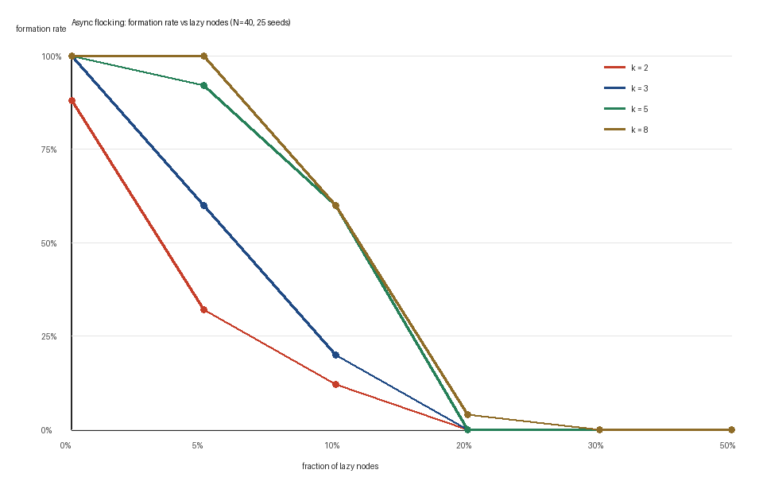

# sim/ · 同协异步船阵实验

> 这是 [同协异步-综述](../docs/同协异步-综述.md) 第 5 节那个实验的实现。

## 一句话

40 艘船，每艘只看得见最近的 k 个邻居，每一步随机决定谁先动。看它们能不能自己排出队形，以及**塞进多少偷懒的船会让队形散掉**。

## 为什么不用 Mesa

综述里写的是 Mesa，实现时改成了纯 numpy。原因有两个：

1. Mesa 的 `Agent` 是逐条 Python 对象，异步逐个体更新会慢 10 倍以上，跑完 600 次要半小时；
2. 这个模型的规则只有三行，Mesa 的调度器在这里没有带来任何东西。

**行为完全等价**：`Flock.step()` 就是 Mesa 的 `Model.step()`，`Flock._update(i)` 就是 `Agent.step()`，只是把调度写死在 20 行里。想迁回 Mesa 的话，把这两个方法包一层就行。

## 跑

```bash
pip install numpy            # 唯一依赖
python async_flock.py --demo     # 看 φ 随时间怎么变
python async_flock.py --sweep    # 全量扫描，约 5 分钟
```

输出：

| 文件 | 内容 |
|---|---|
| `results.csv` | 每次运行的原始记录（600 行） |
| `summary.md` | 按 (k, 偷懒比例) 聚合的表格 |
| `figure.png` | 成队率 vs 偷懒比例，四条线对应 k=2/3/5/8 |

## 模型

个体 i 的规则（三行，对应 boids）：

1. **对齐**：朝最近 k 个邻居的平均方向偏（权重 1.00）
2. **聚合**：朝邻居质心靠（权重 0.20）
3. **分离**：离邻居太近就推开（权重 0.25，距离下限 0.02）

更新方式：`v_new = 0.85·v_old + 0.15·desired`，加 σ=0.03 的噪声，速度固定 0.010，世界是 1×1 的环面。

**异步**：每一步用 `rng.permutation(n)` 打乱顺序，逐个更新——后更新的个体能看见先更新的邻居的**新**位置（高斯-赛德尔）。这就是它和经典 boids 的全部区别。

**偷懒**：`lazy_frac` 比例的个体不更新、但仍被邻居看见、跟着旧方向漂。它模拟的是"在线但不出力"。

**掉线**：`dropout()` 直接把个体从邻居里摘掉（`alive=False`），模拟"人走了"。

## 指标

- **φ（序参量）**：`|mean(单位速度)|`，1 = 全体同向，0 = 完全随机
- **成队**：φ ≥ 0.90 连续 10 步
- **崩溃**：成队后踢掉 20% 节点，200 步内回不到 0.90

## 结果

N=40，每格 25 个种子，上限 400 步。完整表格见 [summary.md](summary.md)，原始记录见 [results.csv](results.csv)。

**成队率**（每个格子 25 次运行里有多少次排出队形）：

| k | 0% 偷懒 | 5% | 10% | 20% | 30% |
|---|---|---|---|---|---|
| 2 | 88% | 32% | 12% | 0% | 0% |
| 3 | 100% | 60% | 20% | 0% | 0% |
| 5 | 100% | 92% | 60% | 0% | 0% |
| 8 | 100% | 100% | 60% | 4% | 0% |



三个能看出来的东西：

1. **崩溃是悬崖，不是斜坡。** 所有 k 都在 10%–20% 之间从"基本能成"掉到"基本不能"。命题二得到支持。
2. **邻域越大越抗。** k=2 在 5% 就掉到 32%，k=8 在 5% 还是 100%。代价是每一步多看 4 倍的邻居——在真实系统里那就是 4 倍的带宽。
3. **k=3 就够成队，但要抗偷懒 k 得更大。** 命题一说的"存在一个最小 k"成立（k=2 明显不够），但"够用"和"抗造"是两个不同的阈值。

**一个必须说清的设计缺陷**：表里的"恢复步数 = 1"没有意义。因为重跑时个体已经对齐（φ≈0.99），踢掉 20% 几乎不影响方向一致性，所以一步就"恢复"了。正确的做法是**在对齐之前就踢人**，或者在踢人瞬间测 φ 的跌幅。这个实验没做，别引用这一列。

## 已知局限（别当真）

1. **环面**：世界是卷起来的，没有边界。真实海面有边界。
2. **同质**：所有船速度一样。真实的船快慢不同。
3. **无通信成本**：观察邻居是免费的。真实场景里每一次"看"都要花带宽——而这恰恰是上一个项目测出来的主要成本（83%）。
4. **单一目标**：只有一个队形。真实任务里可能有多个互相冲突的目标。
5. **掉线时机不对**：只在成队之后测过一次掉线，且测法有缺陷（见上）。真正的"边成队边掉人"没有测。

这五条里，第 3 条最值得先补：给"看邻居"加上每步 n 字节的成本，就能把"协调的性价比"（综述命题三）变成一张图。第 5 条最容易补：把 dropout 换到第 0 步，重跑一次就行。
